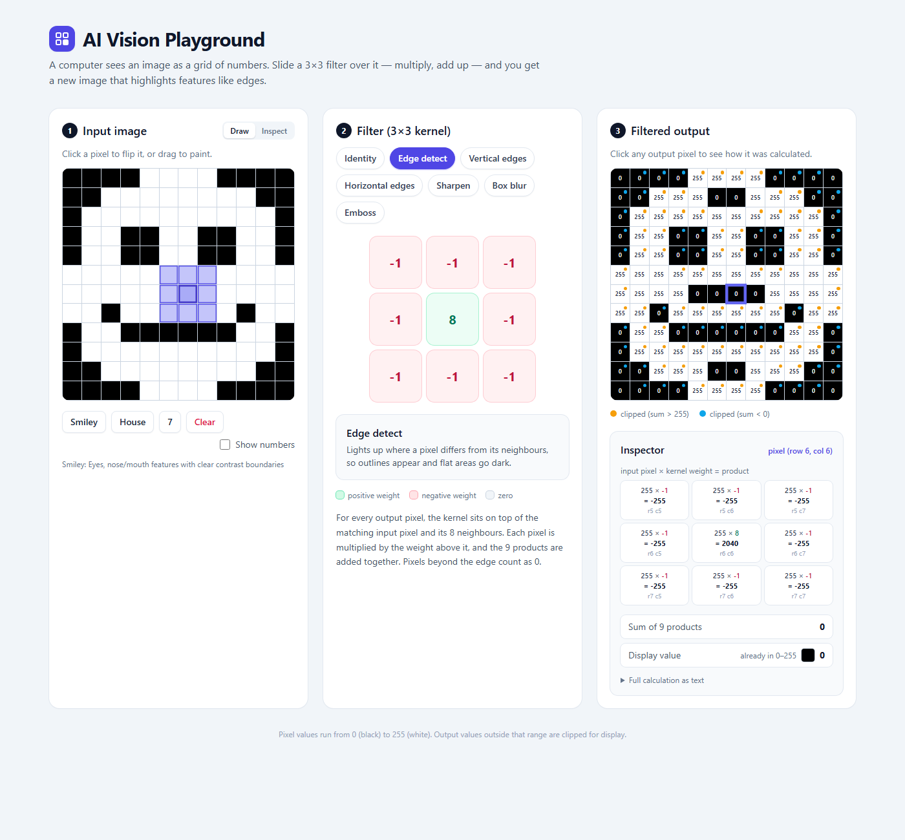

# AI Vision Playground

A zero-build, zero-backend browser playground that shows beginners **how a computer "sees" an image**: as a 2D grid of numbers. You can slide a 3×3 convolution kernel over that grid and watch features like edges appear.

Draw on a 12×12 pixel grid (or load a preset), pick a filter, and click any output pixel to see the exact multiply-and-add math that produced it.



## Features

- **Drawable 12×12 input grid.** Click to flip a pixel between 0 (dark) and 255 (bright), or drag to paint. Presets: **Smiley**, **House**, **7**, plus **Clear**.
- **3×3 filter selector** with colour-coded weights: Identity, Edge detect (Laplacian), Vertical edges (Sobel X), Horizontal edges (Sobel Y), Sharpen, Box blur and Emboss.
- **Live filtered output.** It recomputes on every change. Values outside 0–255 are clipped for display and marked with a dot.
- **Inspector.** Click any pixel to see its 3×3 neighbourhood, all 9 `pixel × weight = product` steps (zero-padded border cells included), the raw sum and the clamped display value.

## Quick start

No install or build step is needed.

```bash
# Option 1: open the file directly
start ui/index.html          # Windows  (macOS: open, Linux: xdg-open)

# Option 2: serve statically
npx serve .                  # then visit /ui/
```

Run the tests (requires Node.js, no dependencies):

```bash
node tests/test_convolution.js
```

## Project structure

```text
ai-vision-playground/
├── SPEC.md                    # Technical spec and folder-isolation rules
├── presets/
│   └── shapes.js              # 12x12 preset pixel grids (smiley, house, seven)
├── filter-engine/
│   └── convolution.js         # 2D convolution + per-pixel step breakdown
├── ui/
│   └── index.html             # Tailwind UI: editor, kernel picker, output, inspector
└── tests/
    └── test_convolution.js    # Dependency-free Node test runner (23 tests)
```

Every module exposes a browser global (`window.*`) **and** CommonJS `module.exports`, so the same file runs in Chrome and in Node tests.

| Module | Browser global | Exports |
| --- | --- | --- |
| `presets/shapes.js` | `window.PRESET_GRIDS` | `{ PRESET_GRIDS }` with `smiley`, `house`, `seven`. Each has `{ id, name, description, grid }` |
| `filter-engine/convolution.js` | `window.Convolution` | `{ applyKernel, explainCell, clampPixel }` |

### Convolution contract

- `applyKernel(grid, kernel)` returns a new same-size grid of **raw** sums, which can be negative or above 255. It uses correlation (no kernel flip, the ML convention) with **zero padding** at the borders. Inputs are never mutated.
- `clampPixel(v)` returns `Math.max(0, Math.min(255, Math.round(v)))`. The UI uses it for display brightness.
- `explainCell(grid, kernel, row, col)` returns `{ row, col, steps[9], sum, clamped, text }`. Each step is `{ kernelRow, kernelCol, gridRow, gridCol, pixel, weight, product, outOfBounds }`.

## Multi-agent architecture

This project was built by an AI coding agent that split the work across **parallel subagents**, using `SPEC.md` as the shared source of truth.

1. **Spec first.** `SPEC.md` defines the folder layout and a **folder-isolation rule**: each folder owns one responsibility, and an agent may only edit files inside its assigned folder.
2. **Shared contract.** Before fanning out, the orchestrating agent fixed the exact API between modules: function signatures, padding and rounding rules, and the `explainCell` return shape. That let the three parts be built independently and still fit together.
3. **Three parallel subagents**, each strictly sandboxed to one folder:

   | Subagent | Folder | Responsibility |
   | --- | --- | --- |
   | Filter engine | `filter-engine/` | Convolution math and the step-by-step explanation |
   | UI | `ui/` | Interactive Tailwind page wired to `PRESET_GRIDS` and `Convolution` |
   | Tests | `tests/` | Hand-computed expectations written against the contract, not the implementation |

4. **Integration check.** Once all three finished, the orchestrator ran the real test suite against the real engine (23/23 passing) and rendered the UI in headless Chrome.

Because the tests encode hand-calculated values from the contract rather than mirroring the implementation, they act as an independent check that the engine's math is right.

## Tech

Plain ES5/UMD JavaScript, Tailwind CSS via CDN and HTML. No bundler, framework or backend.
